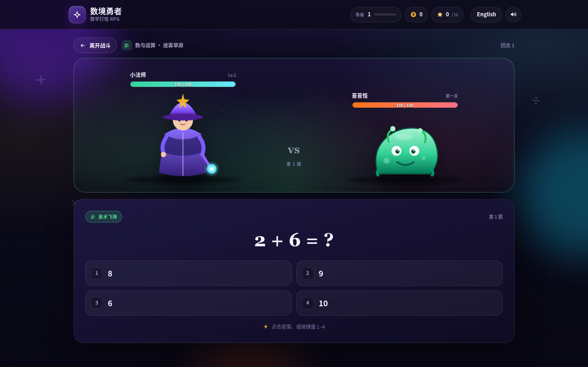
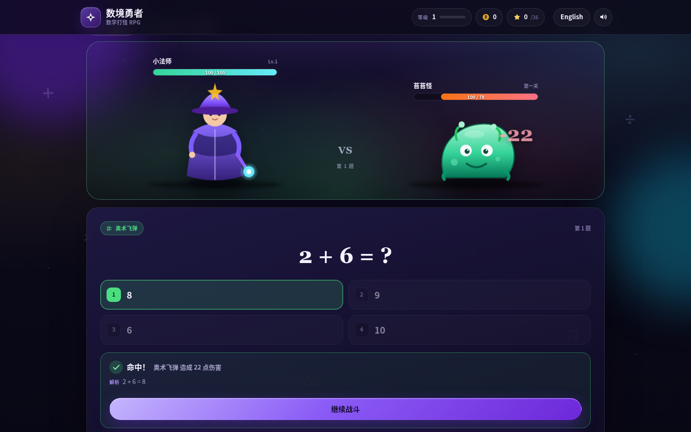
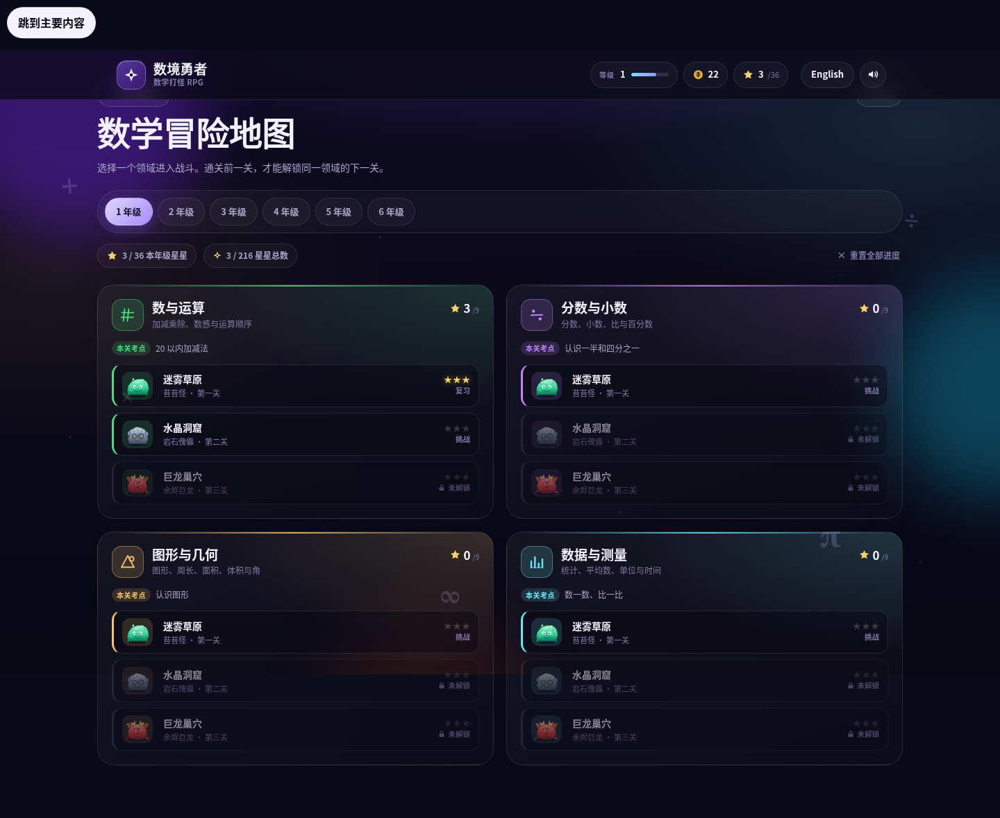
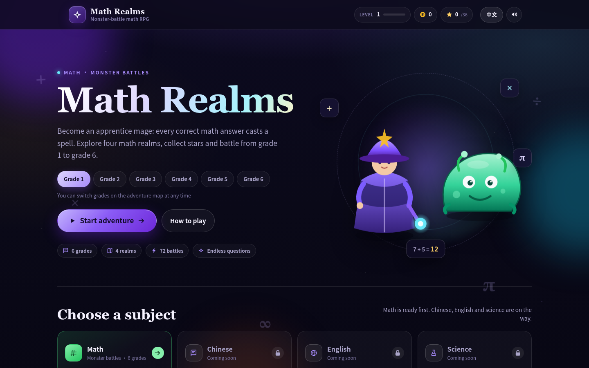

# 数境勇者 · Math Realms

参考 **Prodigy Math** 的打怪闯关式数学 RPG。你扮演小法师，答对数学题就能施法攻击怪物；连续答对伤害更高，答错则会被怪物反击。项目首先实现「数学」学科，覆盖小学一至六年级的四大数学领域，界面、题目和解析都可以在中文和英文之间一键切换。

纯静态、零运行时依赖，不需要构建步骤。


## 快速开始

需要 Node.js 18+（或任意静态文件服务器）：

```bash
npm start
```

打开 <http://127.0.0.1:8080>。

也可以用 Python 起一个静态服务器：

```bash
python3 -m http.server 8080
```

> 请通过 HTTP 打开，不要直接双击 `index.html`。项目使用原生 ES Modules，`file://` 协议下浏览器会拦截模块加载。

## 玩法

1. 在首页选择年级，进入数学冒险地图。
2. 每个年级有 4 个数学领域，每个领域有 3 场战斗，共 72 场。
3. 战斗里答对一题施放一次法术：
   - 基础伤害 22；
   - 连击第 2/3/4 题伤害依次为 28 / 34 / 40；
   - 答错会被怪物反击 20 点，连击中断。
4. 先清空怪物生命即获胜；先被清空生命则战败。
5. 零失误通关得 3 星，错 1 题得 2 星，获胜至少得 1 星。同一领域内，前一关拿到 1 星后才会解锁下一关。
6. 每次战斗获得经验和金币；经验累计提升法师等级。战败也会按答对题数获得少量练习经验。

进度保存在浏览器 `localStorage`（键名 `mathrealms.v1`），不联网、不需要账号。地图页可以重置全部进度。

## 数学内容

| 年级 | 数与运算 | 分数与小数 | 图形与几何 | 数据与测量 |
| --- | --- | --- | --- | --- |
| 1 | 20 以内加减、凑十、简单应用题 | 一半和四分之一 | 认识图形、边数、生活中的形状 | 数一数、比长短 |
| 2 | 100 以内加减、乘法启蒙 | 同分母比较、分数取一份 | 长方形面积/周长、正方形周长、对称轴 | 条形数据比较、钱币 |
| 3 | 三位数加减、乘法口诀、除法 | 等值分数、同分母加减、异分母比较 | 长方形面积/周长、求缺失边 | 数据合计、简单平均数 |
| 4 | 多位数乘法、有余数除法、因数倍数、四舍五入 | 分数加减、带分数化假分数、异分母比较 | 组合图形面积、直线角/直角 | 平均数、中位数、众数、极差、单位换算 |
| 5 | 多位数乘法、小数加减、运算顺序 | 异分母加减、分数乘整数、小数化分数 | 三角形/平行四边形面积、长方体体积 | 平均数、中位数、众数、极差、时间与单位 |
| 6 | 负数加减、比、百分数、运算顺序 | 分数乘除、百分数化分数、比的分数意义 | 圆周长/面积、正方体体积/表面积、三角形内角和 | 统计量、概率、百分数、单位换算 |

题目由带种子的随机数生成器现场生成，不是固定题库；同一关每次进入都会得到不同的数字组合。表达式和文字应用题的答案都在自动化测试中通过独立计算校验。

## 中英文界面

右上角按钮可以随时切换中文 / English，切换范围包括：

- 首页、地图、战斗、结算、帮助和确认对话框；
- 数学领域的名称与说明、每个年级的考点；
- 题目、选项、解析和单位（米/厘米、kg/g 等）；
- 动态拼接的列表（如平均数题中的「4、8 和 6」/「4, 8 and 6」）。

## 截图

| | |
| --- | --- |
|  |  |
|  |  |
|  |  |

更多截图见 [`docs/screenshots/after/`](docs/screenshots/after/)。

## 项目结构

```text
index.html                 页面骨架、SVG 角色与图标
src/styles.css             全部样式、响应式与动效
src/ui/app.js              屏幕渲染、事件、音效、语言切换
src/content/config.js      年级 / 领域 / 关卡 / 学科配置
src/content/questions.js   四个领域的出题器与干扰项生成
src/i18n/zh.js             中文字典
src/i18n/en.js             英文字典
src/i18n/index.js          取词、插值、列表和语言状态
src/engine/battle.js       回合制战斗与星级/奖励规则
src/engine/progress.js     localStorage 进度、解锁、等级
src/engine/rng.js          可复现的种子随机数
scripts/serve.mjs          零依赖静态服务器
tests/                     Node 内置测试器的自动化测试
```

### 加一个领域 / 年级

1. 在 `src/content/config.js` 增加领域（名称、说明、法术、图标、配色）。
2. 在 `src/content/questions.js` 书写该年级 + 领域的出题函数，并登记到对应分派函数。
3. 在 `src/i18n/zh.js` 和 `src/i18n/en.js` 同步添加名称、考点和题目模板；`tests/config.test.js` 会检查两个字典的键是否齐全。
4. 运行 `npm test`。

### 加一个学科

首页已经预留了语文、英语、科学三个「即将开放」入口。新增学科需要独立的内容模块和地图视图；当前的数学 RPG 引擎（战斗、星级、进度、双语）可以直接复用，但学科之间不应共用同一套考点配置。

## 测试

```bash
npm test
```

测试使用 Node.js 内置的 `node:test`，不需要安装依赖，覆盖：

- 6 个年级 × 4 个领域 × 3 个关卡 × 多组随机种子的出题结构、选项去重和双语渲染；
- 表达式题由独立求值器复核，应用题（面积、周长、平均数、中位数、众数、极差、概率、单位换算等）按题干参数复核；
- 中英文字典键完全一致、每个词条非空、插值与列表本地化；
- 战斗伤害、连击、胜负、星级和奖励；
- 进度存储、损坏数据修复、星级只升不降、关卡解锁、等级和重置。

## 可访问性与兼容性

- 键盘操作：战斗中按 `1`–`4` 选择答案，`Enter` 继续；所有按钮都有可见焦点。
- 战斗反馈通过 `aria-live` 播报，结算标题自动获得焦点，地图关卡有完整的无障碍名称。
- 支持 `prefers-reduced-motion`（关闭动效）和 `prefers-contrast: more`（增强对比度）。
- 响应式布局覆盖 320px–1440px；移动端答案改为单列。
- 音效由 Web Audio 实时合成，没有外部音频文件；可一键静音。
- 面向现代浏览器（Chrome / Edge / Safari / Firefox 近两年版本），使用了原生 ES Modules、`<dialog>` 和 `color-mix()`。

## 已知边界

- 当前只有「数学」一个学科；语文、英语、科学入口显示为即将开放。
- 进度只存在本机浏览器，没有账号、云同步或排行榜。
- 题目用于练习和游戏化巩固，不是正式考试题库，也不替代教材和教师。
- 尚无 PWA / Service Worker 离线缓存；所有文件都是静态资源，部署到任意静态托管即可。
- 项目没有接入后端、AI 出题或拍照录题。

## 部署

项目是纯静态站点，把仓库根目录交给任意静态托管即可（GitHub Pages、Netlify、Vercel、Nginx 等）。已包含 `.nojekyll`，在 GitHub Pages 上不需要额外配置构建步骤；如果使用 Pages，请在仓库设置里选择从分支根目录发布。

## License

未指定许可证。仓库目前作为个人学习项目使用。
