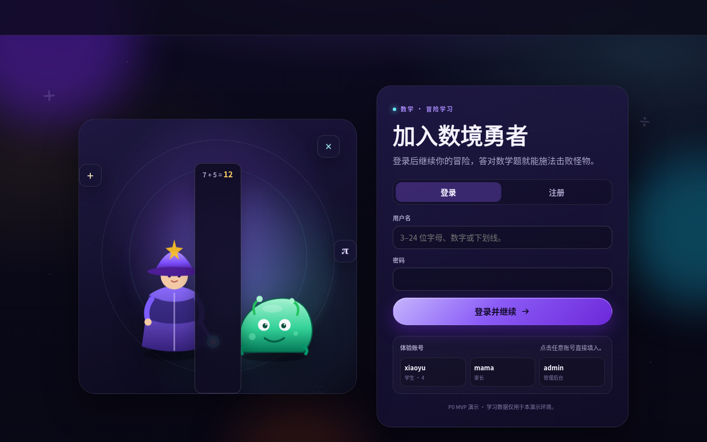

# 数境勇者 · Math Realms（P0 MVP）

参考 **Prodigy Math** 的打怪闯关式数学 RPG。学生答对数学题就能施法攻击怪物；答错会被怪物反击并看到分步解析。项目覆盖小学一至六年级的四大数学领域，支持中英文界面，并配套**服务端权威判题**、**错题本与掌握度**、**家长报告**和**教研运营后台**。

这是一个按《类 Prodigy Math 教学游戏 H5 开发需求文档》实现的 **P0 可试点 MVP 演示**：在单个仓库内跑通「学生游戏闭环 + 答题学习闭环 + 知识与题库 + 题库导入 + AI 草稿审核 + 家长报告 + 运营后台」的纵向切片。生产级的短信、云存储、HTTPS 域名、真实模型和支付接入不在本演示范围内，见文末「范围与限制」。



## 快速开始

环境要求：Node.js **>= 24**（服务端直接运行 TypeScript，使用内置 `node:sqlite`，无需编译数据库驱动）。

```bash
npm install
npm start
```

打开：

- 学生 / 家长端：<http://127.0.0.1:8787>
- 教研运营后台：<http://127.0.0.1:8787/admin>

首次启动会自动创建 `data/mathrealms.sqlite`，并写入 72 个知识点、约 1300 道已发布题目和演示账号。想恢复干净演示数据：

```bash
npm run reset   # 删除 data/mathrealms.sqlite（含 -wal/-shm）
npm start       # 重新建库与种子
```

### 演示账号

| 角色 | 账号 | 密码 | 说明 |
| --- | --- | --- | --- |
| 学生 | `xiaoyu` | `demo1234` | 四年级，已有 2 场学习记录、错题和星星 |
| 学生 | `lele` | `demo1234` | 三年级，用于家长多孩切换 |
| 家长 | `mama` | `demo1234` | 已绑定小雨和乐乐，可查看报告、导出数据 |
| 管理员 | `admin` | `admin1234` | 教研/运营后台 |

登录页也提供一键体验按钮。学生账号注册前需要勾选监护人同意。

## 已实现能力

### 学生端

- **账号与家庭**：学生/家长/管理员登录、注册、家庭码绑定、家长创建孩子档案、隐私同意、退出登录。
- **新手引导**：首次登录展示 5 步引导；设置页可重放。
- **世界地图**：6 个年级 × 4 个数学领域 × 3 关 = 72 场战斗；按前置关卡解锁，显示星星与通关状态；支持断点续玩。
- **答题战斗**：服务端创建会话、抽题、判题；单选、判断、数字填空、分数填空、多选、文本题均有客户端交互；答对施法、连击加伤、答错被反击；怪物、勇者和 HP 条随服务端状态更新。
- **学习闭环**：提示（每题最多 2 条，服务端按次下发）、答错解析、正确答案、错题自动收录、按知识点复习变式题、掌握度更新、星星/经验/金币结算。
- **成长**：等级、经验、金币、累计学习星星、答题数、正确率、学习时长、成就徽章、背包。
- **多角色**：焰羽/霜翎/雷铠三名伙伴，各有独立经验、等级、战斗特色（火焰、冰霜护盾、连击加成）、绝招和 3 档服饰；成长页可切换，等级越高服饰/光环越明显。
- **绝招与难度特效**：关卡 1/2/3 对应 Tier 1/2/3 绝招，高难度出现全屏闪光、终极光环、粒子与震屏。
- **错题本**：按待复习/已掌握筛选、重做同知识点变式题、手动标记掌握。
- **设置与无障碍**：中英文切换、音效开关、字号放大、高对比度、减少动态效果、家庭码和隐私同意状态。
- **响应式**：1440 / 1024 / 768 / 390 / 320 宽度下检查无横向溢出，战斗页答题/反馈时战斗场景保持在视口内；横屏优先，触控按钮尺寸 ≥ 38px。

### 家长端

- 多孩子切换；今日与周期学习时长、答题数、正确率、连续学习天数。
- 周学习柱状图、当前章节、通关关卡、薄弱知识点、最近错题。
- 使用设置（每日分钟、允许时段、提醒、消费审批）。
- 数据导出（JSON）、解除绑定、删除数据申请（写入审计，管理员处理）。
- 孩子登录账号由家长创建时只显示一次初始密码。

### 教研运营后台（`/admin`）

- **运营总览**：题目、已发布、待审核、知识点、学生、答题、错题、AI 草稿指标与最近批次。
- **知识树**：按年级查看知识点，新增/编辑名称、领域、单元、难度、启停状态。
- **题库管理**：按题干/状态/题型/年级筛选；结构化编辑器支持题干、选项、答案、提示、解析（中英双语）；题目草稿 → 发布/下架；编辑生成新版本，学生答题会话保存题目快照。
- **导入中心**：下载 XLSX 多 Sheet 模板或 CSV 单表模板；上传后 dry-run 校验（结构、知识点、答案、重复、媒体/安全），展示有效行、错误行、警告和示例；确认后有效行入草稿；批次可查询、回滚（被引用题目归档而非物理删除）。
- **AI 生成中心**：按知识点/题型/难度/数量创建异步任务；离线数学模板提供方生成草稿；结构校验、数学答案校验、重复提示；逐题审核通过即发布，或填写理由驳回；保留 provider、model、prompt 版本、token/成本和原始结果。
- **账号与审计**：查看学生/家长/管理员；登录、题库、导入、AI 审核、家长绑定、配置变更全部写审计日志。
- **运营配置**：学生端公告、功能开关。

### 服务端

- **Node.js 原生 HTTP + `node:sqlite`**：零框架、零原生编译依赖；SQLite 持久化，便于本地演示和单机部署。
- **服务端权威**：取题接口不返回答案、等价答案或解析；判题、伤害、连击、奖励、星星、等级、掌握度全部由服务端计算。
- **幂等与事务**：同一题重复提交返回已存结果；结算奖励按会话幂等，重复请求不重复发奖；货币变动带流水和幂等键。
- **RBAC 与对象级权限**：学生只能访问自己的会话；家长只能查看已绑定孩子；后台仅管理员。
- **安全基线**：scrypt 密码哈希、HMAC-SHA256 短期令牌、参数化 SQL、内容转义、文件类型/大小校验、登录限流、统一错误结构与请求 ID、CSP/安全响应头。

## 测试与验证

```bash
npm test        # 22 个测试：内容正确性、i18n、判题、角色/绝招、幂等奖励、导入、AI 审核
```

覆盖：

- `tests/*.test.js`：72 个关卡 × 数万道生成题的算术正确性、双语文案、解锁/星星/经验、题目生成器防重复。
- `server/tests/core.test.ts`：密码与令牌、单选/判断/数字容差/分数/多选/文本判题、答案不泄漏、奖励幂等、错题与提示、XLSX 模板往返、导入校验/入库/回滚、AI 草稿审核发布。

浏览器验证使用 Playwright（本机可通过 `CHROME_PATH` 指定浏览器）。`e2e/` 下脚本演示完整学生战斗、家长报告和教研后台流程；截图证据在 [`docs/screenshots/p0`](docs/screenshots/p0)。

## 项目结构

```text
index.html                 学生 / 家长 H5 外壳
admin.html                 教研运营后台外壳
src/ui/                    学生端控制器、API 客户端、屏幕渲染
src/admin/                 后台控制器与样式
src/content/               数学题生成器（服务端种子复用）
src/i18n/                  中英文文案
src/styles.css             学生端样式、响应式与无障碍
server/                    HTTP 路由、SQLite、鉴权、判题、导入、AI
server/tests/              服务端单元/集成测试
tests/                     内容与引擎测试
docs/                      架构、API、验收、部署、安全说明
deploy/                    Dockerfile、compose、Nginx 示例
e2e/                       Playwright 验收与截图脚本
data/                      运行时 SQLite（已 gitignore）
```

## 文档

- [角色、服饰与绝招设计](docs/CHARACTERS_DESIGN.md)
- [冒险地图设计](docs/WORLD_MAP_DESIGN.md)
- [战斗与答题节奏设计](docs/BATTLE_DESIGN.md)
- [架构与数据模型](docs/ARCHITECTURE.md)
- [API 清单](docs/API.md)
- [P0 验收对照与已知限制](docs/ACCEPTANCE.md)
- [部署与运维](docs/DEPLOY.md)
- [安全、隐私与儿童数据](docs/SECURITY_PRIVACY.md)
- [P0 视觉证据](docs/screenshots/p0/README.md)
- [战斗可见性与动画对比](docs/screenshots/battle-fx/README.md)
- [冒险地图对比](docs/screenshots/world-map/README.md)
- [角色/服饰/绝招对比](docs/screenshots/characters/README.md)

## 范围与限制（务必阅读）

- 这是 **P0 演示/可试点 MVP**，不是 12–16 周完整 Beta。生产上线前需补齐真实短信/第三方登录、云 PostgreSQL/Redis、对象存储、HTTPS/备案、监控告警、备份演练、等保/教育 App/游戏分类合规评估。
- **AI 生成** 使用离线数学模板提供方（`local-template`），不调用外部模型、不发送学生数据；接入真实模型只需替换 provider 适配层并补充内容安全过滤。
- **视觉方向**：当前采用暗色奇幻「数境」主题；需求文档建议明亮卡通 2D（文档标注为待确认项），主题色/插画可在不改业务逻辑的前提下替换。
- **技术栈取舍**：需求文档推荐 Phaser 3 + React + NestJS/FastAPI。本仓库为了在单机演示中零构建、可测试、可部署，采用原生 ES Modules + Canvas/CSS 动画 + Node HTTP/SQLite。服务端边界、判题权威、数据模型和页面清单按文档保留；迁移到 Phaser/React/NestJS 时可复用 API、DB 与测试。
- **未实现**：教师/学校端、支付、会员、推送周报、真实 AI 对话、拖拽/几何题型、倒计时自动判负、云备份和监控。这些在文档中属于 P1/P2 或需要外部资源。
- 题目内容为种子生成的练习题库，不替代教研审核；导入/AI 题目默认草稿，必须人工发布才进入学生端。
